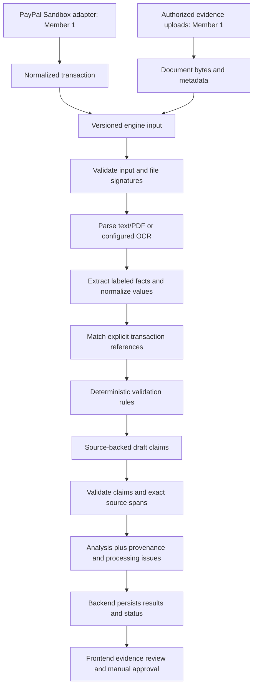

# Member 2: evidence pipeline v1.0

Member 2 owns `ai_engine/` and `contracts/ai-engine/`. The engine is a synchronous
Python library called by Member 1's backend worker. It creates no API, database,
PayPal connection, or payment/submission action. Member 3 consumes the backend API.



## Run and verify

From the repository root, with Python 3.11+:

```sh
python3 -m venv .venv
source .venv/bin/activate
python -m pip install -r backend/requirements.txt -r ai_engine/requirements.txt
python -m ai_engine contracts/ai-engine/sample-input.json
python -m pytest ai_engine/tests backend/tests -q
python -m ai_engine.export_contracts
```

The sample contains only synthetic records. The engine does not use the synthetic
transaction's `evidence_count` to decide whether documents exist: it analyzes only
the documents actually supplied. No credentials or external services are needed.

## Backend handoff

```python
from ai_engine import PipelineInput, run_pipeline

request = PipelineInput.model_validate(payload)
result = run_pipeline(request)
public_response = result.analysis.model_dump(mode="json")
private_worker_result = result.model_dump(mode="json")
```

`result.analysis` uses the existing `backend.app.schemas.Analysis` and `Finding`
models unchanged. The existing HTTP routes and OpenAPI are unchanged, and still
return mock data until Member 1 connects a worker. This is a library contract,
not a new request body for the existing POST `/analyze` route (which still takes `{}`).

Member 1 should create a job, authorize and snapshot its evidence, mark it
`processing`, call the engine in a worker, and persist the returned analysis and
provenance. Invalid input raises `pydantic.ValidationError`; unexpected defects
propagate and should become a generic backend job failure. Do not run CPU-heavy
parsing directly in an async HTTP request handler. Worker timeouts, memory limits,
retries, cancellation, durable state, and merchant access checks belong to that layer.

PayPal Sandbox payment records must be mapped into the existing Transaction model
by Member 1. The engine compares explicit references against `id` and
`paypal_transaction_id`. Use decimal strings for amounts; do not feed raw provider
payloads or secrets to the engine. Current public Transaction supports `COMPLETED`
and two decimal places only; other provider statuses/currency scales require an
agreed contract extension. This implementation does not claim PayPal API connectivity.

## Input and result contracts

- `contracts/ai-engine/input.schema.json`: version, analysis ID, normalized transaction,
  up to 25 documents, and `require_delivery` (default true; backend may set false for
  a transaction whose fulfillment does not require physical delivery).
- Documents supply text for `text/plain`, or validated base64 bytes for PDF, PNG,
  and JPEG. Filenames are metadata and are never opened as paths. Limits are 10 MiB
  per binary file, 50 parsed pages, and 200,000 extracted characters per document.
- `contracts/ai-engine/result.schema.json`: public analysis plus extracted pages,
  normalized facts, document match outcomes, precise finding sources, draft claims,
  and processing issues. Parsed text is sensitive evidence; keep it in private storage
  and avoid general application logs. Source offsets index Python Unicode strings,
  not bytes or JavaScript UTF-16 code units; frontend highlighting must account for this.
- Every fact points to an actual parsed-page substring with document ID, page number,
  start/end character offsets, and quote. These are positions in extracted/OCR text,
  not bounding boxes on the original page. OCR accuracy still needs merchant review.
- Missing-evidence findings have empty source arrays: absence is scoped to this
  supplied evidence set and never supported with a fabricated document reference.
  File-level failures may reference document IDs without a parsed text span.

## Implemented behavior

The initial extractor recognizes one `Label: value` field per line:
`Transaction ID`, `PayPal Transaction ID`, `Payment Reference`, `Amount`, `Total`,
`Grand Total`, `Currency`, `Invoice Date`, `Order Date`, `Delivery Date`,
`Delivered Date`, `Delivery Status`, `Tracking ID`, and `Tracking Number`.
Labels are case-insensitive. Dates must be ISO `YYYY-MM-DD`. Amounts use a decimal
point and optional correctly grouped commas, with optional three-letter currency
before/after the amount. Ambiguous values are excluded and reported as findings.

Matching requires explicit transaction IDs; identical amounts or dates are not
enough. Conflicting references are ambiguous and cannot support draft claims.
Exact byte duplicates are excluded. Rules flag amount/currency differences,
conflicting same-field dates/statuses/amounts, delivery preceding order dates,
missing delivery records, and unreadable/unmatched/insufficient evidence.
Dates from different field types are not required to equal each other.
Document types come from backend metadata; they are not automatically classified.

An empty evidence set returns a completed review with missing-evidence findings.
If every supplied file is unreadable, the analysis fails. Partial read failures
allow a completed review with explicit findings/issues. Completion means processing
finished, not that the evidence is sufficient. No matched facts means no draft.

Drafts attribute statements to documents, do not independently certify delivery,
and remain subject to merchant review. The default is deterministic generation;
no hosted LLM is called. An optional `draft_writer` may select/reorder exact supported
`DraftClaim` objects. New prose, invented sources, empty selections, or adapter
exceptions trigger a deterministic fallback with a `DRAFT_FALLBACK` issue. This
deliberate constraint prevents arbitrary model prose from bypassing source checks.

## OCR and limitations

Text PDFs use `pypdf`. Images require an injected OCR adapter. Optional local image
OCR is provided by `ai_engine.extraction.parser.tesseract_image_reader`; install
`ai_engine/requirements-ocr.txt` and a system Tesseract binary before passing it as
`ocr=`. It supports images, not PDF rendering. Scanned/mixed PDFs require a separate
adapter that accepts PDF bytes and returns one text string per page; without one,
they produce `PDF_OCR_REQUIRED`, not fabricated text. OCR adapter failures are explicit.

This is a testable first implementation, not general invoice understanding. Table
layouts, unlabeled prose, locale-sensitive dates/currencies, document classification,
order-ID link chains, carrier verification, free-form LLM writing, and human edits
need later adapters and tests. Input documents are treated as data, not instructions.
Byte signatures and size limits are not malware scanning or a parser sandbox.
Uploaded document processing should run in an isolated worker with resource limits.

The tests exercise synthetic text, a generated text PDF, the OCR adapter boundary,
matching, conflicting evidence, failures, source tampering, draft hallucinations,
contract drift and compatibility with the existing response model. They do not
verify real Tesseract recognition or live model/PayPal calls.
